<p align="center">
  
</p>

<p align="center">
  <a href="https://www.linkedin.com/in/vladyslav-krutii-598b64356/"></a>
  
  
</p>

---

### `> cat about.txt`

```yaml
name:      Vladyslav Krutii
location:  Ukraine 🇺🇦
study:     BSc Cybersecurity @ Kyiv School of Economics
ctf_team:  KSE_CS1
highlight: Haruul Zangi 2026 Grand Final · Attack & Defense · Mongolia 🇲🇳
interests: [reverse engineering, web security, DevSecOps, tooling]
now:       building projects where security meets infrastructure
```

### `> ls ~/projects --featured`

<p align="center">
  <a href="https://github.com/vladyslav-krutii/secscan">
    
  </a>
  <a href="https://github.com/vladyslav-krutii/kse-air-alerts">
    
  </a>
</p>

| Project | What it is | Stack |
|---|---|---|
| 🛡️ [**secscan**](https://github.com/vladyslav-krutii/secscan) | Security-headers scanner API wrapped in a full DevOps pipeline: hardened multi-stage image, CI with lint → tests → Trivy scan → GHCR, K8s manifests, Prometheus + Grafana monitoring | FastAPI · Docker · Kubernetes · GitHub Actions · Trivy |
| 🚨 [**kse-air-alerts**](https://github.com/vladyslav-krutii/kse-air-alerts) | Hourly per-oblast forecast of new air-raid alerts in Ukraine, evaluated walk-forward so no forecast ever sees the future | Python · pandas · scikit-learn |

### `> stack --list`

<p align="center">
  <br/>
  <br/>
  
</p>

<p align="center">
  
  
  
  
  
</p>

### `> git log --stats`

<p align="center">
  
  
</p>
<p align="center">
  
</p>

<p align="center">
  <picture>
    <source media="(prefers-color-scheme: dark)" srcset="https://raw.githubusercontent.com/vladyslav-krutii/vladyslav-krutii/output/snake-dark.svg?v=3" />
    
  </picture>
</p>


