<p align="center">
  
</p>

<p align="center">
  <a href="https://www.linkedin.com/in/vladyslav-krutii-598b64356/"></a>
  
  
</p>

---

### `> cat about.txt`

```yaml
name:      Vladyslav Krutii
location:  Ukraine 🇺🇦
study:     BSc Cybersecurity @ Kyiv School of Economics
ctf_team:  KSE_CS1
highlight: Haruul Zangi CTF 2026 Grand Final · Attack & Defense · 10th place · Mongolia 🇲🇳
interests: [reverse engineering, web security, DevSecOps, tooling]
now:       DevSecOps: supply-chain security & Kubernetes hardening
```

### `> ls ~/projects --featured`

<p align="center">
  <a href="https://github.com/vladyslav-krutii/secscan">
    
  </a>
  <a href="https://github.com/vladyslav-krutii/kse-air-alerts">
    
  </a>
  <a href="https://github.com/vladyslav-krutii/k8s-attack-defense-lab">
    
  </a>
</p>

| Project | What it is | Stack |
|---|---|---|
| 🛡️ [**secscan**](https://github.com/vladyslav-krutii/secscan) | Security-headers scanner API, secured end to end:<br/>• SSRF found & fixed in my own scanner (resolve-then-allowlist, every redirect re-validated)<br/>• Abuse protection: rate limit, concurrency cap, scan deadline<br/>• Value-based header grading, A to F<br/>• Supply chain: SHA-pinned actions, Gitleaks, Semgrep, pip-audit, Trivy, SBOM, Cosign keyless signing<br/>• Kyverno admits only images signed by my CI<br/>• Default-deny NetworkPolicy egress as a second SSRF layer<br/>• STRIDE threat model | FastAPI · Docker · Kubernetes · GitHub Actions · Cosign · Kyverno |
| ☸️ [**k8s-attack-defense-lab**](https://github.com/vladyslav-krutii/k8s-attack-defense-lab) | Kubernetes security lab: one app deployed twice, vulnerable vs hardened:<br/>• 6 misconfigurations exploited, then blocked: privileged pod + hostPath, over-permissive SA token, no NetworkPolicy, secrets in env/ConfigMap, root + writable FS + no limits, mutable image tags<br/>• Every scenario has a `verify.sh`; CI rebuilds the lab on kind and requires 6/6 exploitable vs 6/6 blocked<br/>• Hardening: Pod Security `restricted`, per-workload RBAC, default-deny NetworkPolicy, secrets as files, read-only FS, images pinned by digest<br/>• Kyverno 1.20: 9 CEL `ValidatingPolicy`, 105 offline `kyverno test` cases<br/>• Falco 0.45 (modern eBPF, not privileged) with 6 custom detection rules | kind · Calico · Kyverno · Falco · Kustomize · GitHub Actions |
| 🚨 [**kse-air-alerts**](https://github.com/vladyslav-krutii/kse-air-alerts) | Hourly per-oblast forecast of new air-raid alerts in Ukraine, evaluated walk-forward so no forecast ever sees the future | Python · pandas · scikit-learn |

### `> stack --list`

<p align="center">
  <br/>
  <br/>
  
</p>

<p align="center">
  
  
  
  
  
  
  
  
</p>

### `> git log --stats`

<p align="center">
  
  
</p>
<p align="center">
  
</p>

<p align="center">
  <picture>
    <source media="(prefers-color-scheme: dark)" srcset="https://raw.githubusercontent.com/vladyslav-krutii/vladyslav-krutii/output/snake-dark.svg?v=3" />
    
  </picture>
</p>


